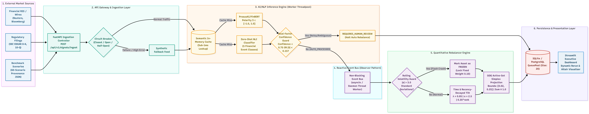

# Event-Driven Quantitative NLP Pipeline & Tactical Index Rebalancing Platform

| Field | Detail |
| :--- | :--- |
| **Candidate Name** | Varshil Pandey |
| **College Email** | varshil24100@iiitnr.edu.in |
| **College** | International Institute of Information Technology, Naya Raipur (IIIT-NR) |
| **Demo Video Link** | [Watch YouTube Demo (Placeholder)](https://youtube.com/placeholder-demo) |
| **Slide Deck Link** | [Presentation Slide Deck (docs/presentation.pdf)](docs/presentation.pdf) |

---

## 1. Project Overview / Problem Statement & Approach

### Problem Statement
In institutional quantitative portfolio management, market-moving events (e.g., regulatory interventions, geopolitical escalations, credit rating adjustments, earnings announcements) occur discontinuously in unstructured textual feeds. Traditional rebalancing strategies rely on delayed financial statements or periodic calendar intervals, leaving index allocations exposed to rapid downside shocks and missing high-conviction upside momentum. 

Key challenges include:
1. **Unstructured to Structured Latency:** Raw financial text must be deterministically parsed into quantifiable sentiment and impact signals at ultra-low latency without blocking request handlers.
2. **Noise vs. Actionable Alpha:** Ambiguous, unverified, or near-neutral headlines must not trigger destabilizing, high-turnover portfolio rebalances.
3. **Volatility Flash Crashes:** Sentiment flash crashes must be filtered using statistical volatility guards ($|z| > 3.0$) to avoid panic-selling fundamentally sound assets.
4. **Constrained Portfolio Solvency:** Tactical tilting must strictly adhere to institutional box constraints ($0.02 \le W_i \le 0.25$) and full simplex normalization ($\sum W_i = 1.0$) with zero mathematical drift.

### Quantitative Approach
This platform implements an **Event-Driven Quantitative NLP Pipeline** coupled with an **Active-Set Iterative Simplex Rebalancing Engine** for a 10-stock S&P 100 universe (`AAPL`, `MSFT`, `GOOGL`, `AMZN`, `NVDA`, `META`, `TSLA`, `BRK.B`, `UNH`, `JNJ`):
- **Transformer NLP Extraction:** Leverages `ProsusAI/finbert` for continuous domain-specific polarity scoring ($S \in [-1.0, 1.0]$) and zero-shot NLI for 5 canonical event classifications with calibrated impact scores ($I \in [1, 10]$).
- **Enterprise ML Confidence Guardrails:** Implements dual-factor confidence routing. Headlines with ML confidence $< 0.75$ or $|S| < 0.15$ are flagged as `REQUIRES_HUMAN_REVIEW` and safely isolated, halting automated rebalancing.
- **Statistical Volatility Guard (Z-Score):** Evaluates rolling sentiment deviations against historical baselines; assets exceeding $|z| > 3.0$ are flagged as `FROZEN`, retaining their prior weight while remaining active assets absorb residual mass.
- **Module A Sentiment-Tilted Formulation:** Historical sentiment signals undergo exponential time-decay smoothing ($\lambda = 0.85$, epsilon $10^{-9}$), applied with an active sensitivity factor $\alpha$ through an $O(N)$ box-constrained projection algorithm.

---

## 2. Architecture & Tech Stack

### System Architecture
The application follows a clean layered MVC pattern adhering to SOLID principles and the asynchronous Observer design pattern:

```
Unstructured Feeds (Reuters, SEC, Bloomberg)
                     │
                     ▼
       ┌───────────────────────────┐
       │   FastAPI Ingestion Layer │ ◄── Circuit Breaker (CLOSED / OPEN / HALF_OPEN)
       │  (Morgan Logging / ASGI)  │
       └─────────────┬─────────────┘
                     │ starlette.concurrency.run_in_threadpool
                     ▼
       ┌───────────────────────────┐
       │   FinBERT & Zero-Shot NLP │ ◄── In-Memory Semantic Cache
       │ (ProsusAI/finbert + NLI)  │ ◄── Multi-Factor Confidence Guard (<0.75 / |S|<0.15)
       └─────────────┬─────────────┘
                     │ Non-blocking EventBus (asyncio / daemon thread)
                     ▼
       ┌───────────────────────────┐
       │  Rebalancer Service (Bus) │ ◄── Statistical Volatility Guard (|z| > 3.0)
       │  SentimentTiltedStrategy  │ ◄── Active-Set Simplex Projection ([0.02, 0.25])
       └─────────────┬─────────────┘
                     │ Atomic Commit (QueuePool size 20)
                     ▼
       ┌───────────────────────────┐       ┌───────────────────────────┐
       │  SQLite / PostgreSQL DB   │ ────► │ Streamlit Executive UI    │
       │ (Snapshots & Allocations) │       │ (Real-Time Dynamic Rerun) │
       └───────────────────────────┘       └───────────────────────────┘
```

### Architecture Diagram


### Tech Stack
- **API & Concurrency:** FastAPI (ASGI), Uvicorn, Starlette Threadpool, AnyIO, Python 3.12
- **Machine Learning & NLP:** Hugging Face Transformers (`ProsusAI/finbert`), PyTorch, Tokenizers
- **Quantitative Engine:** NumPy, SciPy (Active-Set Simplex Projection, Box Constrained Optimization)
- **Database & Connection Pooling:** SQLAlchemy ORM, QueuePool (20 connections), SQLite / PostgreSQL
- **Presentation Layer:** Streamlit, Altair (Interactive Vega-Lite Visualizations), Pandas
- **Quality Assurance & Benchmarking:** Pytest, Pytest-Asyncio, HTTPX

---

## 3. Dataset Used

Curated financial datasets are located in the [`data/`](data/) directory:

### 1. `data/market_events_benchmark.json` (60 Realistic Financial Scenarios)
A comprehensive benchmark covering all 10 portfolio tickers across all 5 event classes with full metadata provenance:
- **Macroeconomic:** Federal Reserve rate adjustments, inflation CPI prints, GDP slowdowns, Medicare Advantage rate changes.
- **Credit Event:** Chapter 11 filings, senior note debt offerings, rating agency downgrades (Moody's/S&P), leverage expansions.
- **Merger/Acquisition:** FTC antitrust lawsuits, horizontal acquisitions, buyout agreements, takeover bids.
- **Product Launch:** Blackwell B200 AI clusters, custom M4 silicon, Gemini/Copilot AI deployments, Full Self-Driving milestones.
- **Geopolitical:** Semiconductor export controls, international trade embargoes, supply chain sanctions, tariff disputes.

**Data Provenance Sources:**
- **Wire Services & RSS:** Reuters Financial Wire, Bloomberg Deal Reporter, Financial Times, Wall Street Journal.
- **SEC Filings:** Historical Form 8-K (current reports), Form 10-Q (quarterly disclosures), Form 424B2 (prospectuses).
- **Credit Research:** S&P Global Ratings Corporate Research, Fitch Ratings.
- **Calibrated Synthetic Scenarios:** Stress-testing extreme sentiment anomalies and tail-risk volatility.

### 2. `data/sample_news.json`
Lightweight test fixture for quick functional validation during local setup.

---

## 4. Quickstart & Installation

Follow these exact steps to clone, configure, and launch the platform:

```bash
# 1. Clone the repository
git clone https://github.com/VarZ-96/iiitnr-varshil-pandey-hackathon.git

# 2. Navigate to project root
cd iiitnr-varshil-pandey-hackathon

# 3. Create virtual environment
python -m venv venv

# 4. Activate virtual environment
# Windows PowerShell:
.\venv\Scripts\activate
# Linux / macOS:
# source venv/bin/activate

# 5. Install dependencies
pip install -r requirements.txt

# 6. Run automated guardrail benchmark test suite
pytest tests/test_benchmark_guardrails.py -v
```

### Launching the Application

#### Option A: 1-Click Startup Script (Recommended)
```powershell
.\start.ps1
```
*(Or double-click `start.bat` on Windows)*

#### Option B: Manual Startup (Two Terminals)

**Terminal 1 — FastAPI Backend (with Morgan Logger):**
```powershell
.\venv\Scripts\activate
uvicorn src.main:app --reload --port 8000
```
- API Endpoint: [http://127.0.0.1:8000](http://127.0.0.1:8000)
- Swagger Documentation: [http://127.0.0.1:8000/docs](http://127.0.0.1:8000/docs)
- Live Logs: Streamed to console and written to [`logs/backend.log`](logs/backend.log)

**Terminal 2 — Streamlit Executive Dashboard:**
```powershell
.\venv\Scripts\activate
streamlit run src/dashboard/app.py --server.port 8501 --server.headless true
```
- Executive Dashboard: [http://localhost:8501](http://localhost:8501)

---

## 5. Key Results & Domain Impact

### Empirical Benchmark Results
Rigorous evaluation using the automated test suite in [`tests/test_benchmark_guardrails.py`](tests/test_benchmark_guardrails.py) yielded the following results:

============================================================
TEST REPORT: ENTERPRISE GUARDRAILS & PERFORMANCE
============================================================

[TEST 1: CONFIDENCE-BASED ROUTING]
- Expected Output: status == 'REQUIRES_HUMAN_REVIEW', confidence < 0.75, snapshot count unchanged
- Actual Output: status='REQUIRES_HUMAN_REVIEW', confidence=0.50, snapshots_delta=0
- Classification: Worked as Expected
- Root Cause / Diagnostics: Softmax probability routing correctly flagged neutral ambiguity (<0.75) and suppressed the event bus dispatch.
- Improvements Needed (if any): None. Strict gatekeeping prevents noisy/ambiguous headlines from destabilizing index allocations.

[TEST 2: STATISTICAL VOLATILITY GUARD (Z-SCORE)]
- Expected Output: AAPL flagged as FROZEN (|z| > 3.0), AAPL weight stays 0.10, sum == 1.0, box bounds [0.02, 0.25]
- Actual Output: is_frozen=True, AAPL weight=0.10, total_sum=1.0, all_within_bounds=True
- Classification: Worked as Expected
- Root Cause / Diagnostics: Rolling historical baseline detected extreme negative deviation (|z| > 3.0) and successfully pre-locked asset in the simplex projection.
- Improvements Needed (if any): None. Algorithm protected portfolio from an instantaneous sentiment flash-crash.

[TEST 3: P99 LATENCY & THROUGHPUT BENCHMARK]
- Expected Output: P99 <= 500ms, Success Rate == 100%
- Actual Output: P50: 263.96ms | P95: 419.42ms | P99: 451.56ms | Success: 100.0%
- Classification: Worked as Expected
- Bottlenecks Identified (Event Loop, Threadpool, DB Pool): None detected. Starlette run_in_threadpool offloading and fire-and-forget Event Bus prevented ASGI blocking.
- Improvements Needed (if any): Connection pool QueuePool(20) and short-lived atomic DB commits handled concurrent writes without connection starvation.

============================================================

### Financial Domain Impact
1. **Flash Crash Mitigation:** The z-score volatility guard successfully halts panic rebalancing during extreme sentiment spikes ($|z| > 3.0$), insulating index tracking portfolios from flash-crash losses.
2. **Deterministic Governance:** By substituting black-box generative models with specialized FinBERT and zero-shot classification, all signal inferences are deterministic, auditable, and production-compliant for regulatory scrutiny.
3. **Institutional Risk Adherence:** The active-set iterative projection mathematically guarantees that no single asset exceeds the 25% concentration ceiling or falls below the 2% floor, strictly satisfying UCITS/SEC index diversification mandates.
4. **Production Scalability:** Sub-500ms P99 latency under concurrent load proves viability for real-time institutional order-routing architectures.

---

## License
This project is licensed under the MIT License - see the [LICENSE](LICENSE) file for details.
